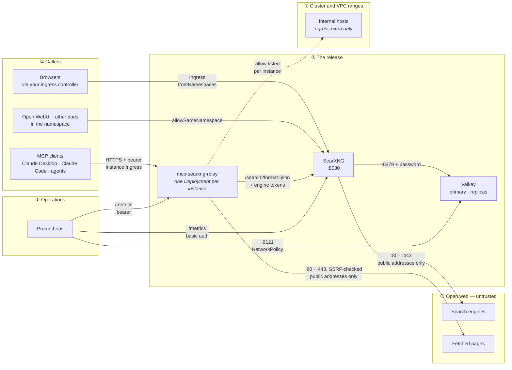

[](https://artifacthub.io/packages/search?repo=littleoffice-searxng)

# searxng-helm

A hardened Helm chart for [SearXNG](https://docs.searxng.org), the self-hosted metasearch engine — built for clusters where every workload must pass a restricted admission policy and no credential may pass through a values file, a rendered manifest or a Helm release history. It can also deploy [mcp-searxng-relay](https://github.com/littleoffice/mcp-searxng-relay) beside SearXNG, giving AI agents web search through your own instance.

**Who this is for.** Teams running SearXNG on Kubernetes — often as the private search backend for AI agents — under Pod Security `restricted` or an admission controller with the same rules, with secrets managed outside Helm (External Secrets, SealedSecrets, SOPS) and, often, Argo CD or Flux doing the deploying.

**What's distinctive.** The hardening is enforced, not suggested. The chart refuses to render an override that would run a container as root, allow privilege escalation, add a capability, or drop the read-only root filesystem or the seccomp profile, so a bad override fails at `helm template` rather than at your admission controller — or nowhere. There are no init containers anywhere. And no values key takes secret material: settings.yml, where SearXNG keeps engine tokens and API keys, is a Secret you own, and the chart never renders it.

**Signed releases.** Every published version is signed keyless with cosign and carries build provenance. Its GitHub Release also carries an SBOM for every image the chart pins, and an image scan report from the moment it shipped.

---

## Contents

- [Features](#features)
- [Architecture](#architecture)
- [Quick start](#quick-start)
- [MCP relay](#mcp-relay)
- [Configuration](#configuration)
- [Security notes](#security-notes)
- [Documentation](#documentation)
- [Companion projects](#companion-projects)
- [Attribution](#attribution)
- [License](#license)

---

## Features

- **[No init containers](https://github.com/littleoffice/searxng-helm/blob/main/docs/architecture.md#starting-searxng-without-an-init-container)** — SearXNG starts on a read-only root filesystem with settings.yml mounted, and Valkey replicas take their role from the config file they mount.
- **[Rootless, enforced at render time](https://github.com/littleoffice/searxng-helm/blob/main/docs/security-model.md#nothing-runs-as-root)** — SearXNG `977`, Valkey `999:1000`, the relay `1001`; all capabilities dropped, `RuntimeDefault` seccomp, no ServiceAccount token. An override that weakens any of it fails the render.
- **[settings.yml from a Secret you own](https://github.com/littleoffice/searxng-helm/blob/main/docs/configuration.md#settingsyml)** — the chart mounts it and never renders, reads or defaults it, so engine `tokens`, `api_key`s and proxy credentials stay out of Helm.
- **[No credential in values](https://github.com/littleoffice/searxng-helm/blob/main/docs/security-model.md#no-credential-is-ever-a-values-field)** — every credential comes from a Secret you name or is generated straight into one; the schema rejects the old inline fields.
- **[GitOps-safe](https://github.com/littleoffice/searxng-helm/blob/main/docs/security-model.md#gitops-caveat)** — every generated credential has an `existingSecret` form, for Argo CD and Flux, where the cluster lookup that keeps it stable returns nothing.
- **[Deny-by-default NetworkPolicies](https://github.com/littleoffice/searxng-helm/blob/main/docs/architecture.md#network-policies)** — ingress from an allow-list only; egress to DNS, Valkey and the internet minus private ranges, so a compromised pod cannot pivot into the cluster.
- **[Valkey](https://github.com/littleoffice/searxng-helm/blob/main/docs/configuration.md#valkey)** — standalone, or a primary with replicas; ephemeral or persistent; password kept out of the process list. Or bring your own.
- **[The limiter](https://github.com/littleoffice/searxng-helm/blob/main/docs/configuration.md#the-limiter)** — `limiter.toml` rendered and mounted, with the `trusted_proxies` trap spelled out.
- **[MCP relay instances](https://github.com/littleoffice/searxng-helm/blob/main/docs/mcp-relay.md)** — one relay Deployment per instance, each with its own tokens, ConfigMap, NetworkPolicy and Ingress, all against one SearXNG.
- **[Engine scoping](https://github.com/littleoffice/searxng-helm/blob/main/docs/mcp-relay.md#scoping-a-relay-to-specific-engines)** — each relay instance reaches only the private engines its token unlocks, enforced by SearXNG.
- **[Persistent fence signing key](https://github.com/littleoffice/searxng-helm/blob/main/docs/mcp-relay.md#verifying-the-signatures-with-fence-gateway)** — mounted from a Secret, so a verifying [fence-gateway](https://github.com/littleoffice/fence-gateway) can pin the relay's key across rollouts and replicas.
- **[Metrics](https://github.com/littleoffice/searxng-helm/blob/main/docs/observability.md)** — ServiceMonitors for SearXNG, each relay instance and Valkey, each behind a credential or a NetworkPolicy of its own.
- **[Pinned images](https://github.com/littleoffice/searxng-helm/blob/main/docs/supply-chain.md#images)** — every image pinned by digest, bumped by Renovate as one patch release, and scanned on every change and daily.
- **[Signed releases](https://github.com/littleoffice/searxng-helm/blob/main/docs/supply-chain.md#build-provenance)** — a keyless cosign signature, provenance attestations, and SBOMs and a scan report per release.
- **[Tested on real clusters](https://github.com/littleoffice/searxng-helm/blob/main/.github/ci/README.md#jobs)** — six scenarios installed, tested and upgraded in place under Helm 3 and Helm 4, and the last published release upgraded to every change without re-minting a credential.

---

## Architecture

One namespace, three workloads, and a NetworkPolicy around each. Everything not
drawn below is denied.



**What each boundary enforces.**

| Boundary | Control | Failure mode it prevents |
|---|---|---|
| ① → SearXNG | NetworkPolicy ingress allow-list (`fromNamespaces`, `from`, `allowSameNamespace`); an empty allow-list admits nothing | Any pod in the cluster using the instance; an empty allow-list quietly meaning "everyone" |
| ① → relay | Bearer token per identity, the instance's own ingress allow-list, TLS at its Ingress | Unauthenticated tool use; tokens crossing the network in clear |
| relay → SearXNG | Engine tokens per instance (`SEARXNG_TOKENS`), enforced by SearXNG | One team's agents selecting another team's private engines |
| SearXNG → Valkey | Password from a Secret, read from `valkey.conf`; only SearXNG and the replicas admitted | Another pod reading or writing Valkey; the password showing up in `ps` |
| ② → ③ | Egress on 80/443 to public addresses only: RFC 1918, link-local and CGNAT ranges excluded | A compromised pod reaching cluster services, the VPC or cloud metadata |
| ② → ④ | Per-instance `networkPolicy.egress.extra`, matched by the relay's `FETCH_ALLOWED_HOSTS` | An internal host opened at one layer but not the other, or to every instance at once |
| pods → API server | ServiceAccount token not mounted, `enableServiceLinks: false` | A compromised pod calling the Kubernetes API with its token |

The network rows need a CNI that enforces NetworkPolicy; on one that does not
(stock Flannel) they render and do nothing.

What the chart renders, and every rule in full: [Architecture](https://github.com/littleoffice/searxng-helm/blob/main/docs/architecture.md).

---

## Quick start

You need a settings.yml: the chart has no default for it and refuses to render
without one. [`examples/settings.example.yml`](https://github.com/littleoffice/searxng-helm/blob/main/examples/settings.example.yml) is a worked one.

```console
kubectl create namespace search
kubectl -n search create secret generic searxng-settings \
  --from-file=settings.yml=./settings.yml

helm install searxng oci://ghcr.io/littleoffice/charts/searxng -n search \
  --set searxng.existingSettingsSecret=searxng-settings
```

Add `--version` to pin a release, and [verify its signature](#verifying-the-chart)
first. Before you expose SearXNG through an Ingress, put your ingress
controller's namespace in `networkPolicy.ingress.fromNamespaces`, or the
NetworkPolicy blocks it ([how](https://github.com/littleoffice/searxng-helm/blob/main/docs/installation.md#before-you-install)).

Installing from a clone, the ready-made values and Secrets in `examples/`, and
the cluster requirements are in [docs/installation.md](https://github.com/littleoffice/searxng-helm/blob/main/docs/installation.md).

---

## MCP relay

`mcpRelay.enabled` deploys [mcp-searxng-relay](https://github.com/littleoffice/mcp-searxng-relay)
next to SearXNG, already pointed at it:

```yaml
mcpRelay:
  enabled: true
  instances:
    - name: default
      existingConfigMap: relay-config   # everything non-secret about this relay
      auth:
        identities:
          - name: claude-desktop
          - name: agent-ci
```

| Term | What it is |
|---|---|
| Instance | One relay Deployment, with its own tokens, engine scope, ConfigMap, NetworkPolicy and Ingress |
| Identity | One caller of an instance: a line in its token file, an audit label and a rate-limit bucket |

Callers that must not reach each other's engines need separate instances.
Tokens are generated into each instance's Secret and survive upgrades. Your
settings.yml has to list `json` in `search.formats`; the chart cannot add it to
a file it does not write.

Configuration layers, engine scoping, ingress, replicas and internal URLs:
[docs/mcp-relay.md](https://github.com/littleoffice/searxng-helm/blob/main/docs/mcp-relay.md).

---

## Configuration

SearXNG's own settings live in your settings.yml; how the chart deploys it is in
`values.yaml`. Most deployments set these:

| Value | Purpose |
|---|---|
| `searxng.existingSettingsSecret` | The Secret holding settings.yml. Required |
| `networkPolicy.ingress.fromNamespaces` | Namespaces allowed to reach SearXNG — your ingress controller's goes here |
| `ingress.*` | Expose SearXNG; an empty `className` means the cluster's default IngressClass |
| `searxng.existingSecret` | `secret_key` from a Secret you manage; required under GitOps ([why](https://github.com/littleoffice/searxng-helm/blob/main/docs/security-model.md#gitops-caveat)) |
| `valkey.architecture` | `standalone` (the default) or `replication` |
| `searxng.limiter.enabled` | Render `limiter.toml`; mirrors `server.limiter` in your settings.yml |
| `mcpRelay.enabled` / `mcpRelay.instances` | The relay instances ([MCP relay](#mcp-relay)) |
| `metrics.serviceMonitor.enabled` | ServiceMonitors for every component whose metrics are on |

Every key is commented in [`values.yaml`](https://github.com/littleoffice/searxng-helm/blob/main/values.yaml); the
ones that need more than a comment are in [docs/configuration.md](https://github.com/littleoffice/searxng-helm/blob/main/docs/configuration.md).
Upgrading from 1.x: [docs/upgrading.md](https://github.com/littleoffice/searxng-helm/blob/main/docs/upgrading.md).

---

## Security notes

**The setup to run.** Each step closes a gap the defaults leave open:

1. **Verify the chart before installing it.** `helm install` checks neither
   the signature nor the provenance ([below](#verifying-the-chart)).
2. **Narrow the ingress allow-lists.** `allowSameNamespace` is on by default
   for SearXNG and every relay instance, so any pod in the namespace can reach
   them. Name the callers with `fromNamespaces` or `from`, and turn it off
   where you can.
3. **Bring your own Secrets under GitOps.** Generated credentials stay stable
   through a cluster lookup that Argo CD and Flux never run
   ([GitOps caveat](https://github.com/littleoffice/searxng-helm/blob/main/docs/security-model.md#gitops-caveat)).
4. **Terminate TLS in front of every relay instance.** The relay speaks plain
   HTTP, and bearer tokens must not cross the network in clear.
5. **Give each team its own relay instance**, with its own engine tokens and
   `FETCH_ALLOWED_HOSTS`, rather than one instance shared by callers that must
   not see each other's engines.
6. **Put fence-gateway in front of the relay**, with a persistent fence key,
   so the relay's signatures are checked rather than decoration
   ([how](https://github.com/littleoffice/searxng-helm/blob/main/docs/mcp-relay.md#verifying-the-signatures-with-fence-gateway)).

**What the chart cannot check.** It never reads your settings.yml, your relay
ConfigMaps or your Secrets, so what is in them is not validated at render time:
a metrics password that does not match, a missing `json` format or an
over-broad `FETCH_ALLOWED_HOSTS` shows up at runtime. And the NetworkPolicies
are only as good as the CNI enforcing them.

**How the code was written.** The project is entirely AI-generated: an AI
assistant (Claude) wrote the chart, the documentation, and the CI and release
workflows. One maintainer directs the work, decides which changes are merged,
and is accountable for every release. What that means for a reviewer is in the
[development process](https://github.com/littleoffice/searxng-helm/blob/main/docs/supply-chain.md#development-process).

### Verifying the chart

Every published version is signed keyless with cosign: the certificate is
bound to the release workflow's OIDC identity and expires in minutes, so
there is no private key held anywhere and no public key to distribute. The
identity is the thing you check, not a fingerprint.

```console
cosign verify ghcr.io/littleoffice/charts/searxng:1.0.0 \
  --certificate-identity-regexp '^https://github.com/littleoffice/searxng-helm/\.github/workflows/release\.yaml@' \
  --certificate-oidc-issuer https://token.actions.githubusercontent.com

gh attestation verify oci://ghcr.io/littleoffice/charts/searxng:1.0.0 \
  --repo littleoffice/searxng-helm
```

Note that `helm install` does not check either of these. Neither does the
`--verify` flag, which looks for a PGP-signed `.prov` file that this chart
does not ship. Run the checks above as a separate step, or enforce them in
an admission controller.

Report vulnerabilities privately: [docs/SECURITY.md](https://github.com/littleoffice/searxng-helm/blob/main/docs/SECURITY.md). Build provenance: [docs/supply-chain.md](https://github.com/littleoffice/searxng-helm/blob/main/docs/supply-chain.md).

---

## Documentation

| Document | Contents |
|---|---|
| [Installation](https://github.com/littleoffice/searxng-helm/blob/main/docs/installation.md) | Requirements, the published chart, installing from a clone, examples, validating changes, known limitations |
| [Configuration](https://github.com/littleoffice/searxng-helm/blob/main/docs/configuration.md) | settings.yml, custom engines, the limiter, Valkey, ingress, Open WebUI, notable values |
| [MCP relay](https://github.com/littleoffice/searxng-helm/blob/main/docs/mcp-relay.md) | Instances and identities, configuration layers, engine scoping, exposing it, fence-gateway |
| [Architecture](https://github.com/littleoffice/searxng-helm/blob/main/docs/architecture.md) | What the chart renders, every NetworkPolicy rule, starting without an init container |
| [Security model](https://github.com/littleoffice/searxng-helm/blob/main/docs/security-model.md) | The security posture, render-time enforcement, where each credential lives, GitOps |
| [Metrics](https://github.com/littleoffice/searxng-helm/blob/main/docs/observability.md) | ServiceMonitors, what each `/metrics` endpoint exposes, scrape credentials |
| [Upgrading to 2.0.0](https://github.com/littleoffice/searxng-helm/blob/main/docs/upgrading.md) | Values that moved, settings.yml out of values, the NetworkPolicy behaviour change |
| [Examples](https://github.com/littleoffice/searxng-helm/blob/main/examples/README.md) | Ready-made values files and Secrets, and which Secrets an install needs |
| [Supply-chain statement](https://github.com/littleoffice/searxng-helm/blob/main/docs/supply-chain.md) | How the code was written, the images and their pins, build provenance, verification, known gaps |
| [Security policy](https://github.com/littleoffice/searxng-helm/blob/main/docs/SECURITY.md) | Supported versions and how to report a vulnerability |

---

## Companion projects

- **[mcp-searxng-relay](https://github.com/littleoffice/mcp-searxng-relay)** — the
  MCP server this chart deploys beside SearXNG: web search and URL fetching for
  AI agents through your own instance, every response in an Ed25519-signed
  `<sec:fence>`, every call attributed to an identity. This chart is its
  reference deployment.
- **[fence-gateway](https://github.com/littleoffice/fence-gateway)** — the
  verifying gateway for those signatures. It sits between the MCP client and
  the relay and checks every response before it reaches the model; its
  [deployment guide](https://github.com/littleoffice/fence-gateway/blob/main/docs/deployment.md#kubernetes--searxng-helm)
  shows how to put it in front of a relay from this chart.

---

## Attribution

The chart owes its shape to [kubitodev/searxng](https://github.com/kubitodev/helm),
which was the only actively maintained SearXNG chart when this one was written
(the official `searxng/searxng-helm-chart` was archived in May 2025).
SearXNG itself is [searxng/searxng](https://github.com/searxng/searxng).

---

## License

Copyright (C) 2026 littleoffice

Licensed under the GNU Affero General Public License, version 3; see [LICENSE](https://github.com/littleoffice/searxng-helm/blob/main/LICENSE).

In plain words: you may use, change, and build commercial services on this software. If you distribute it, or let other people use a modified version over a network, you must offer them its complete source under the same license. This summary is a reading aid; the license text is what applies.
